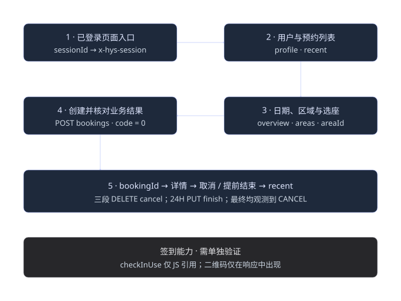

# 预约流程

> [文档索引](README.md) · [API](api.md)

## there 四入口

| 步骤 | 请求 / 动作 | 下一步需要的数据 | 成功判定 |
| --- | --- | --- | --- |
| 1 | 登录并打开所选移动入口 | 本站 Cookie、页面 `sessionId`、资源类型 | 业务用户已验证 |
| 2 | `GET /api/v3/my/profile` 与 `GET /api/v3/my/bookings/recent` | 当前用户和已有预约 | `code=0` 且用户非匿名 |
| 3 | 查询日期概览与区域列表 | 候选日期、`areaId` | 目标区域允许查询 |
| 4 | 按完整时段查询 `areas/{areaId}` | 当前 `rooms[]`、座位状态与规则 | 选中未禁用且可预约的座位 |
| 5 | `POST /api/v3/bookings` | 成功响应的 `data[0].id` | HTTP 正常且 JSON `code=0` |
| 6 | 查询 `bookings/{bookingId}` 与 `recent` | 实际时间、状态、`abilities` | 目标预约可核对 |
| 7 | 按 `abilities` 取消或提前结束 | 操作响应 | 再查 `recent` 核对最终状态 |

`areaId` 来自区域列表，`rooms[]` 使用区域详情返回的当前座位对象，`subject` 和 `meetingMembers` 分别取当前用户姓名与 ID。`roomId`、`areaId`、`bookingId` 分别代表座位、区域和预约，不可互换。日期规则、能力与座位状态都应在操作前重新查询。

创建体的基本结构为：

```json
{
  "rooms": ["<当前区域详情返回的完整座位对象>"],
  "times": [{
    "startDate": "<YYYY-MM-DD>",
    "startTime": "<HH:mm>",
    "endDate": "<YYYY-MM-DD>",
    "endTime": "<HH:mm>"
  }],
  "subject": "<profile.data.name>",
  "meetingMembers": ["<profile.data.id>"]
}
```

上面 `rooms[0]` 表示应直接使用当前查询到的对象，并非向服务端发送字符串占位符。`book --dry-run` 会组装实际请求体，便于在提交前检查。`code` 是业务结果，不能仅凭 HTTP 200 判断成功。创建超时或响应不明确时，应先查询 `recent`，以免重复预约。详情中的 `abilities` 决定能否取消或结束；状态字段本身不足以判断可执行操作。



## 超星座位

先查询房间、座位和目标时段。首次预约与续约都通过提交接口，所需的动态 `enc` 应从对应页面重新取得。签到、暂离、回座、退座使用当前预约的 `seatReserve.id`；退座的调用方式见 [超星座位](chaoxing.md)。
